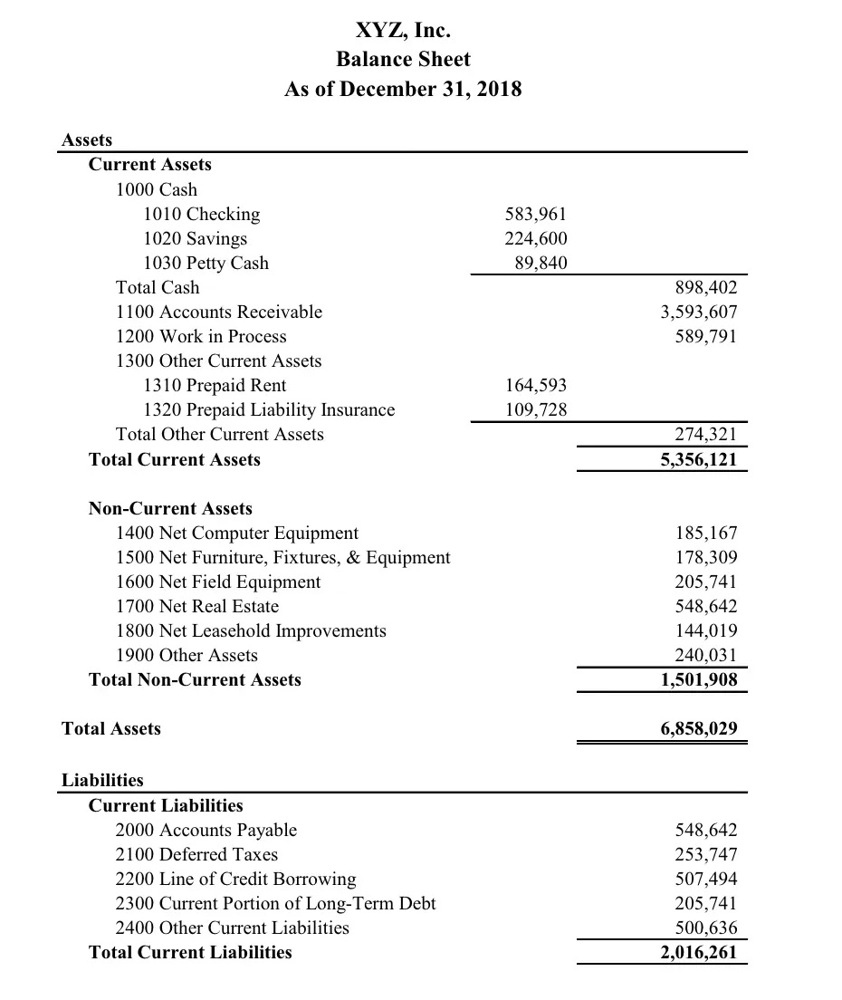
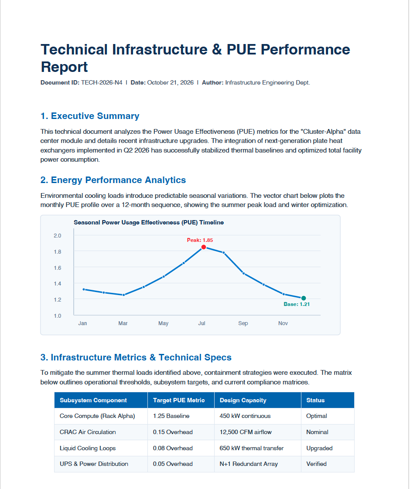

# one-prompt-doc

The purpose of this project is to study the conversion and extraction of text using artificial intelligence. Good software packages that do not use artificial intelligence already exist for the conversion between different formats and therefore also for the extraction, such as [textract](https://textract.readthedocs.io/en/stable/) or [MarkItDown](https://github.com/microsoft/markitdown).

## Framework

For photographed or scanned text, recognition has always been difficult and not always good. I began with the vLLM framework, but the support for macOS and Apple Silicon is not good enough. MLX-VLM, however, is more specific and easier to use.

Another useful resource is the [Docling](https://github.com/docling-project/docling) project, which combines the use of artificial intelligence with the conversion to and from a large number of formats, including photographed and scanned documents.

## Prompt Engineering

### ASD-STE100 Skill

On 2 October 2026, Andrej Karpathy suggested in a [post on X](https://x.com/karpathy/status/2105819303471976479?s=20) to write specifications using the ASD-STE100 format, a controlled subset of the English language used in the aerospace industry. The purpose is to simplify the language and make it precise. I had GPT-6 Astra generate a Skill based on the asd-ste100-issue-9 specification. 

[Skill Documentation](./docs/products/asd-set100-skill/index.md)

### DocLang Skill

I asked GPT-6 Astra to read the [DocLang](https://doclang.ai) specification (version 0.8) and create a Skill that teaches an arbitrary model how to read an image, extract the text, and transform it into an XML file as specified. 

[Skill Documentation](./docs/products/doclang-skill/index.md)

### LLMWiki

I asked GPT-6 Astra to generate a Skill that helps me manage an LLMWiki in OKF format ([Open Knowledge Format](https://github.com/GoogleCloudPlatform/knowledge-catalog/blob/main/okf/SPEC.md) 0.2)

[Skill Documentation](./docs/products/llmwiki-skill/index.md)

## Models

For the generation and management of the project, where not stated otherwise, I use the latest versions of Qwen (currently 3.8 27b), Ollama (engine), GitHub Copilot (VSC plugin), and Claude Code. The purpose is to ensure local use of all the software, without relying on external services.

The initial idea is to use small, dedicated models trained specifically for text extraction from images.

### Deepseek-OCR-2

There is a dependency problem between mlx-vlm and the support files of the model. Qwen was still able to create a patch that solves the problem. These issues are common in fast-changing fields, but they waste time and do not allow a stable environment. Deepseek-OCR-2 is also relatively large, even though it is quite fast.

The results are very modest. The text is recognized, but the recognition is coarse. A summary like the one below is reduced to a title and an undifferentiated table. Here the grouping of the text is relevant and is completely missing.

### Granite-Docling-258M

The model is very light and produces a DocLang XML file, which Docling then uses to generate one of the supported formats. It works well with linear documents, but it cannot map the layout correctly when the layout exists and is important for the understanding of the content. From a technical point of view, everything works well as long as the code that uses the model and the code that does the conversion (Docling) have separate and distinct dependencies. When I tried to use Docling on macOS with MLX, I ran into a whole series of problems and a maze of dependencies and adjustments. This is not the right way to read structured documents. The aim of a project like this is to simplify the code and reduce the dependencies. Adding artificial intelligence to Docling, almost as if it were a new plugin, goes in the opposite direction, and you lose all the possible advantages.

Here too the results are modest. The previous summary is recognized and treated differently, but the final result is flat and identical. The test with the technical report below goes even worse: the model extracts the chart as an image and ignores everything else.

### Other Dedicated Models

With mlx-community/GLM-OCR-bf16, datalab-to/surya-ocr-2, and mlx-community/olmOCR-2-7B-1025-mlx-8bit, I got no better results.

### Other Models

Here the approach is different and uses a Skill and a pre-built agent, such as Claude Code, Codex, or GitHub Copilot, or a custom agent programmed for the specific use.